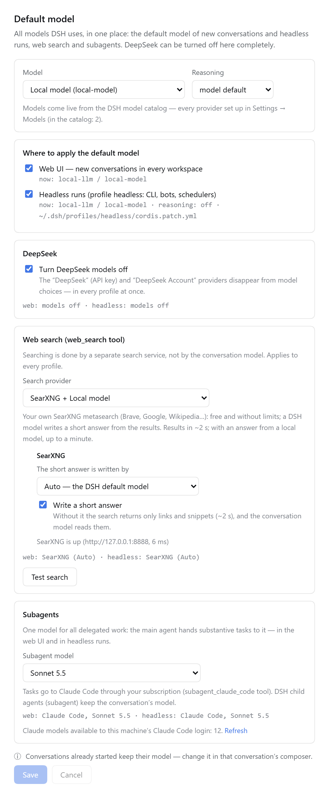

# dsh-model-settings

Two plugins for [DeepSeek Harness (DSH)](https://github.com/deepseek-ai/deepseek-harness)
that put every model choice of DSH on one settings page: the default model of every
profile, a switch that turns DeepSeek off completely, the web search provider, and the
model that subagents run on. The logic is written in Go; DSH loads thin JavaScript
modules that start the Go program and connect it to DSH.

[Русская версия](README.ru.md)

| Package | What it does |
| --- | --- |
| [`dsh-model-defaults`](packages/dsh-model-defaults) | The **Default model** page in DSH Web settings, the host routes behind it, and the subagent guard. |
| [`dsh-web-search-extra`](packages/dsh-web-search-extra) | Extra providers for the `web_search` tool: **SearXNG** (with an optional short answer written by a DSH model), **Claude** through a Claude Code subscription, and **Auto**. |

The page works without the search plugin; the extra search options then show as not installed.

## Why

DSH has no single "default model" setting:

* the model last picked in any conversation's composer silently becomes the default — for the `web` profile only;
* headless runs (`dsh --profile headless`: CLI jobs, bots, schedulers) keep their own default, which the UI cannot change;
* DeepSeek is part of the base profile: its providers cannot be removed on the Models page, and `web_search` calls the DeepSeek API whatever model you use.

## The settings page



Settings → **Default model**:

* **Model** and **reasoning effort**, from the live DSH model catalog — every provider set up in Settings → Models.
* **Where to apply it**: the web UI (new conversations in every workspace) and the `headless` profile. The current model of each is shown; the ticks are remembered.
* **Turn DeepSeek models off** in every profile at once.
* **Web search**: DeepSeek (the DSH default), SearXNG, Claude, or Auto (DeepSeek → SearXNG → Claude, the first answer wins). **Test search** runs one real query.
* **Subagents**: one choice for all delegated work — Auto (the conversation's model), a Claude model through Claude Code, or any model of the DSH catalog. The choice is enforced: a subagent on another model is refused (see [Subagent guard](packages/dsh-model-defaults#subagent-guard)).
* Hints: conversations already started keep their model; a **Restart DSH Web** button appears only when the live model list no longer matches the profile file.

### Models are listed automatically

* **DSH models** come from the same catalog the composer uses (`sessionController.modelCatalog()`), so a provider added in Settings → Models appears on the page at once.
* **Claude models** come from Claude Code itself: the program starts the machine's Claude Code (the native binary of the Claude Agent SDK in the DSH profile, or `claude` on `PATH`) and reads the model list from its `initialize` answer — the call behind the SDK's `supportedModels()`. No message is sent, so no tokens are spent; the list is cached for an hour, and the **Refresh** link asks again. Without Claude Code or a login the page falls back to the aliases `opus`, `sonnet`, `haiku` and says so.

### Languages

English, Chinese and Russian. The page follows the DSH language setting (Settings → General → Language) and falls back to English. DSH versions without a Russian UI language get one added by the plugin; untranslated DSH texts then show in English.

## How it works

DSH loads plugins as Node.js modules, and the settings page runs in the browser. So each plugin is
a thin module that starts the `dsh-model-settings` program (`dsh-model-settings serve`) and talks to
it over stdin/stdout — one JSON message per line, requests in both directions.

* **The module** (JavaScript, inside DSH) registers the routes, the `tools/execute` hook and the
  `web_search` providers, and lends the program the DSH services it needs: the model catalog, the
  default model, `ctx.llm` and `ctx.web`.
* **The program** (Go) does everything else: the page's state and saves, reading and editing profile
  patches under DSH's lock, the `dsh --dump-config` check and rollback, Claude Code runs (model list
  and search), SearXNG search and its model-written answer, and the subagent guard's decisions.

One program process runs per plugin instance and stops when DSH closes the link; if it stops on its
own, the next call starts it again. The browser page (`packages/dsh-model-defaults/lib/client.js`)
stays JavaScript.

| Path | Role |
| --- | --- |
| `cmd/dsh-model-settings` | the program: `serve` for DSH, plus a few commands for checks by hand |
| `internal/defaults` | the settings page: state, save, test search, restart |
| `internal/profile` | what a profile patch says, the changes the page makes, edit/compose/rollback of a file |
| `internal/yamledit` | in-place YAML editing: only the lines of changed keys and rows are rewritten |
| `internal/guard` | the subagent guard (decisions, fallback to the default model) |
| `internal/search` | SearXNG, Claude and Auto search providers |
| `internal/claudecode` | Claude Code over its stream-json protocol, the Claude model list |
| `internal/fsutil` | DSH's profile lock and atomic write |
| `internal/i18n` | server messages and file comments (en, ru, zh) |
| `internal/rpc`, `internal/host` | the link to the DSH side |
| `shim/sidecar.js` | the JavaScript side of the link, shared by the plugin modules |
| `packages/*` | the DSH packages: manifests, bundle patches, plugin modules, the browser page |

## Requirements

* DSH 0.2.1 or newer (tested with 0.2.1-rc.5) and its Node.js (22+).
* Go 1.22+ to build the program — on the DSH machine or on any other (see below).
* `pnpm` on `PATH` when running `dsh plugin add` (it forwards to pnpm).
* For SearXNG search: a SearXNG instance with the JSON format on (see [SearXNG](#searxng)).
* For Claude search and Claude subagents: the `@deepseek-ai/dsh-subagent-claude-code` plugin and a Claude Code login on the machine.
  On a headless machine prefer a long-lived token from `claude setup-token` (a `claude /login` session
  expires after a few weeks): put `CLAUDE_CODE_OAUTH_TOKEN=…` into `~/.dsh/.env` for these plugins, and into
  `env` of `~/.claude/settings.json` for Claude subagents (DSH strips variables named like `*TOKEN*` from the
  environment of the processes it starts).

## Install

```bash
git clone https://github.com/usamoilov/dsh-model-settings ~/src/dsh-model-settings
cd ~/src/dsh-model-settings
go build -o bin/ ./cmd/dsh-model-settings      # or: make build

# the page and the guard, in the profile DSH Web runs on
dsh plugin --profile web add link:$HOME/src/dsh-model-settings/packages/dsh-model-defaults

# the search providers, in every profile whose agents should use them
dsh plugin --profile web add link:$HOME/src/dsh-model-settings/packages/dsh-web-search-extra
dsh plugin --profile headless add link:$HOME/src/dsh-model-settings/packages/dsh-web-search-extra

# then restart DSH Web the way you run it (running conversations are interrupted),
# e.g. as a systemd user service: systemctl --user restart <your-unit>.service
```

No Go on the DSH machine? Build elsewhere and copy the file into `bin/` of the clone:

```bash
GOOS=linux GOARCH=amd64 CGO_ENABLED=0 go build -trimpath -o dsh-model-settings ./cmd/dsh-model-settings
scp dsh-model-settings dsh-host:src/dsh-model-settings/bin/
```

The modules look for the program in: the plugin option `binary`, `$DSH_MODEL_SETTINGS_BIN`,
`<clone>/bin/dsh-model-settings`, `dsh-model-settings` on `PATH`.

To update: `git pull` in the clone, build the program again, restart DSH Web. `link:` installs read
the modules from the clone; when the program and the modules do not match, the DSH log says so.

## Configure

Both plugins work without configuration. Optional settings go into the plugin's row in
`~/.dsh/profiles/web/cordis.patch.yml`:

```yaml
- id: model-defaults
  config:
    # profiles the page manages (default: the running one and headless, if present)
    profiles: [web, headless]
    # your systemd --user unit of DSH Web, if it runs as one; enables the Restart button (off by default)
    webUnit: dsh-web.service
    # extra --patch files that restate the Claude subagent model (for a service run as
    # `dsh --profile headless --patch base.patch.yml --patch extra.patch.yml`)
    overlays:
      - path: ~/svc/extra.patch.yml
        label: My service
        profile: headless
        patches: [~/svc/base.patch.yml]   # patches applied before it, for the compose check
    # SearXNG address for the health line on the page
    searxngURL: http://127.0.0.1:8888
```

Search provider settings are described in [`dsh-web-search-extra`](packages/dsh-web-search-extra#configuration),
the guard's in [`dsh-model-defaults`](packages/dsh-model-defaults#subagent-guard).

## SearXNG

Any SearXNG instance with the JSON output format works. A private one in Docker, bound to localhost:

```bash
mkdir -p ~/searxng/config
docker run -d --name searxng --restart unless-stopped \
  -p 127.0.0.1:8888:8080 -v ~/searxng/config:/etc/searxng \
  --memory 400m --cpus 1 searxng/searxng:latest
```

The first start writes `~/searxng/config/settings.yml`. In it, set `search.formats` to
`[html, json]`, `server.limiter: false` (the instance is private) and a random
`server.secret_key`, then `docker restart searxng`. Keep `settings.yml` out of git — it holds the secret key.

## Security

* All routes are DSH routes: they need the DSH login cookie. `POST` routes also require
  the header `x-dsh-model-defaults: 1` and a JSON body, so another site cannot send them as a form.
  The session cookie is never passed to the program.
* Profile files are edited in place: only the lines of the keys and rows that change are rewritten —
  comments, blank lines, quoting, folded strings, flow lists and `!!js` expressions elsewhere stay
  byte for byte, and a change that means nothing leaves the file untouched. Writes run under DSH's
  profile lock (the one its config editor and `dsh plugin` take), are atomic, and keep a backup
  (`cordis.patch.yml.bak-model-defaults-*`, last 5). After each write
  `dsh --profile <name> --dump-config` must succeed and contain the chosen provider, otherwise the file
  is rolled back.
* Restart runs `systemctl --user --no-block restart <webUnit>` only when `webUnit` is configured
  (a unit name is checked, never a shell string).
* Claude Code runs get a minimal environment (plus Claude auth variables such as
  `CLAUDE_CODE_OAUTH_TOKEN` when DSH has them), no settings, hooks, CLAUDE.md or MCP servers, and no
  saved session. The model list is read without sending a prompt; Claude search allows the WebSearch
  tool only, in an empty temporary folder.

## Command line

The program also runs by hand, for checks:

```bash
bin/dsh-model-settings read-profile ~/.dsh/profiles/headless/cordis.patch.yml   # what the page reads (JSON)
bin/dsh-model-settings claude-models ~/.dsh/profiles/web                        # Claude Code's model list
bin/dsh-model-settings search searxng latest stable Node.js version             # SearXNG results
bin/dsh-model-settings search -claude-model haiku claude-code latest Node.js    # one Claude search (uses your limits)
bin/dsh-model-settings version
```

## Tests

```bash
go test ./...                                           # unit tests, Go only
go build -o bin/ ./cmd/dsh-model-settings
node shim/test/integration.test.mjs                     # the three plugin modules against the program in a fake DSH
node packages/dsh-model-defaults/test/client.test.mjs   # renders the page in every language (no browser)
go test -tags live -v ./internal/profile                # on a DSH machine: real profiles are only read
```

`make test` runs the first four. The integration test needs only Node.js and the built program; the live
test reads the real profiles, edits them in memory and runs `dsh --dump-config` once.

## Uninstall

```bash
dsh plugin --profile web remove dsh-model-defaults dsh-web-search-extra
dsh plugin --profile headless remove dsh-web-search-extra
# and restart DSH Web
```

Changes made through the page stay in the profiles. Before removing, switch web search back to
DeepSeek and untick "Turn DeepSeek models off" if you want DSH's defaults back, or delete the rows
marked `# dsh-model-defaults: …` from `cordis.patch.yml`.

## License

[MIT](LICENSE)
