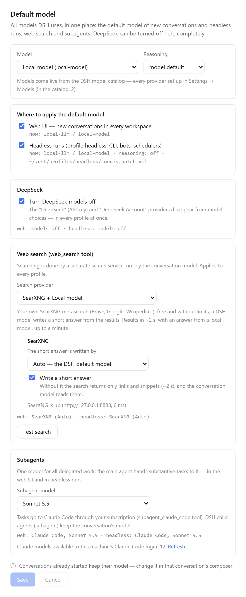

# dsh-model-settings

Two plugins for [DeepSeek Harness (DSH)](https://github.com/deepseek-ai/deepseek-harness)
that put every model choice of DSH on one settings page: the default model of every
profile, a switch that turns DeepSeek off completely, the web search provider, and the
model that subagents run on.

[Русская версия](README.ru.md)

| Package | What it does |
| --- | --- |
| [`dsh-model-defaults`](packages/dsh-model-defaults) | The **Default model** page in DSH Web settings and the host routes behind it. |
| [`dsh-web-search-extra`](packages/dsh-web-search-extra) | Extra providers for the `web_search` tool: **SearXNG** (with an optional short answer written by a DSH model), **Claude** through a Claude Code subscription, and **Auto**. |

The page works without the search plugin; the extra search options then show as not installed.

## Why

DSH has no single "default model" setting:

* the model last picked in any conversation's composer silently becomes the default — for the `web` profile only;
* headless runs (`dsh --profile headless`: CLI jobs, bots, schedulers) keep their own default, which the UI cannot change;
* DeepSeek is part of the base profile: its providers cannot be removed on the Models page, and `web_search` calls the DeepSeek API whatever model you use.

## The settings page



Settings → **Default model**:

* **Model** and **reasoning effort**, from the live DSH model catalog — every provider set up in Settings → Models.
* **Where to apply it**: the web UI (new conversations in every workspace) and the `headless` profile. The current model of each is shown.
* **Turn DeepSeek models off** in every profile at once.
* **Web search**: DeepSeek (the DSH default), SearXNG, Claude, or Auto (DeepSeek → SearXNG → Claude, the first answer wins). **Test search** runs one real query.
* **Subagents**: one choice for all delegated work — Auto (the conversation's model), a Claude model through Claude Code, or any model of the DSH catalog.
* Hints: conversations already started keep their model; a **Restart DSH Web** button appears only when the live model list no longer matches the profile file.

### Models are listed automatically

* **DSH models** come from the same catalog the composer uses (`sessionController.modelCatalog()`), so a provider added in Settings → Models appears on the page at once.
* **Claude models** come from Claude Code itself: the plugin asks the Claude Agent SDK for `supportedModels()` of the local Claude Code login. The probe sends no message, so no tokens are spent; it is cached for an hour, and the **Refresh** link asks again. Without the SDK or a login the page falls back to the aliases `opus`, `sonnet`, `haiku` and says so.

### Languages

English, Chinese and Russian. The page follows the DSH language setting (Settings → General → Language) and falls back to English. DSH versions without a Russian UI language get one added by the plugin; untranslated DSH texts then show in English.

## Requirements

* DSH 0.2.1 or newer (tested with 0.2.1-rc.5) and Node.js 22+.
* `pnpm` on `PATH` when running `dsh plugin add` (it forwards to pnpm).
* For SearXNG search: a SearXNG instance with the JSON format on (see [SearXNG](#searxng)).
* For Claude search and Claude subagents: the `@deepseek-ai/dsh-subagent-claude-code` plugin and a Claude Code login on the machine.

## Install

```bash
git clone https://github.com/usamoilov/dsh-model-settings ~/src/dsh-model-settings

# the page, in the profile DSH Web runs on
dsh plugin --profile web add link:$HOME/src/dsh-model-settings/packages/dsh-model-defaults

# the search providers, in every profile whose agents should use them
dsh plugin --profile web add link:$HOME/src/dsh-model-settings/packages/dsh-web-search-extra
dsh plugin --profile headless add link:$HOME/src/dsh-model-settings/packages/dsh-web-search-extra

# then restart DSH Web the way you run it (running conversations are interrupted),
# e.g. as a systemd user service: systemctl --user restart <your-unit>.service
```

To update: `git pull` in the clone and restart DSH Web. `link:` installs read the plugin from the clone.

## Configure

Both plugins work without configuration. Optional settings go into the plugin's row in
`~/.dsh/profiles/web/cordis.patch.yml`:

```yaml
- id: model-defaults
  config:
    # profiles the page manages (default: the running one and headless, if present)
    profiles: [web, headless]
    # your systemd --user unit of DSH Web, if it runs as one; enables the Restart button (off by default)
    webUnit: dsh-web.service
    # extra --patch files that restate the Claude subagent model (for a service run as
    # `dsh --profile headless --patch base.patch.yml --patch extra.patch.yml`)
    overlays:
      - path: ~/svc/extra.patch.yml
        label: My service
        profile: headless
        patches: [~/svc/base.patch.yml]   # patches applied before it, for the compose check
    # SearXNG address for the health line on the page
    searxngURL: http://127.0.0.1:8888
```

Search provider settings are described in [`dsh-web-search-extra`](packages/dsh-web-search-extra#configuration).

## SearXNG

Any SearXNG instance with the JSON output format works. A private one in Docker, bound to localhost:

```bash
mkdir -p ~/searxng/config
docker run -d --name searxng --restart unless-stopped \
  -p 127.0.0.1:8888:8080 -v ~/searxng/config:/etc/searxng \
  --memory 400m --cpus 1 searxng/searxng:latest
```

The first start writes `~/searxng/config/settings.yml`. In it, set `search.formats` to
`[html, json]`, `server.limiter: false` (the instance is private) and a random
`server.secret_key`, then `docker restart searxng`. Keep `settings.yml` out of git — it holds the secret key.

## Security

* All routes are DSH routes: they need the DSH login cookie. `POST` routes also require
  the header `x-dsh-model-defaults: 1` and a JSON body, so another site cannot send them as a form.
* Profile files are edited with DSH's own `yaml` library (comments and `!!js` expressions survive),
  under DSH's profile lock, with an atomic write and a backup (`cordis.patch.yml.bak-model-defaults-*`,
  last 5 kept). After each write `dsh --profile <name> --dump-config` must succeed and contain the chosen
  provider, otherwise the file is rolled back.
* Restart runs `systemctl --user --no-block restart <webUnit>` only when `webUnit` is configured.
* The Claude model probe starts Claude Code with no tools, no settings, hooks or MCP servers, and a minimal
  environment; it never sends a prompt. Claude search runs Claude Code with the WebSearch tool only, in an
  empty temporary folder.

## Tests

On a machine with DSH installed (the plugins borrow `yaml` and the profile lock from the DSH install; it is found through the running DSH, `dsh` on `PATH`, or `DSH_ROOT`):

```bash
cd packages/dsh-model-defaults
node test/unit.test.mjs      # reading and editing profiles
node test/modules.test.mjs   # messages, config, Claude model list
node test/client.test.mjs    # renders the page in every language (no browser needed)
node test/live.test.mjs      # real profiles are only read; writes go to a temp copy

cd ../dsh-web-search-extra
node test/unit.test.mjs
node test/live.test.mjs            # needs SearXNG
node test/live.test.mjs --claude   # plus one Claude search (uses your Claude limits)
```

`client.test.mjs` and the search plugin's `unit.test.mjs` need nothing but Node.js.

## Uninstall

```bash
dsh plugin --profile web remove dsh-model-defaults dsh-web-search-extra
dsh plugin --profile headless remove dsh-web-search-extra
# and restart DSH Web
```

Changes made through the page stay in the profiles. Before removing, switch web search back to
DeepSeek and untick "Turn DeepSeek models off" if you want DSH's defaults back, or delete the rows
marked `# dsh-model-defaults: …` from `cordis.patch.yml`.

## License

[MIT](LICENSE)
