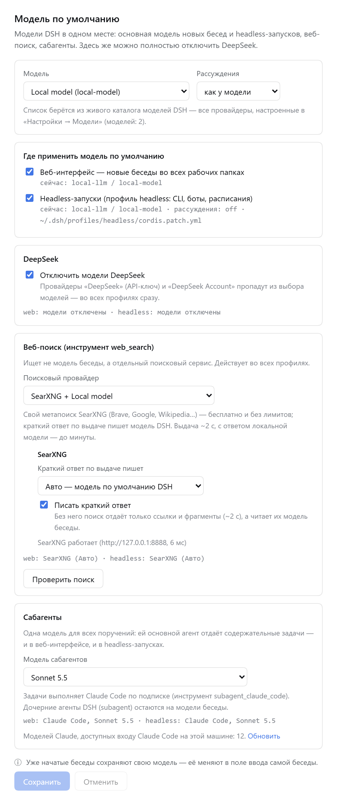

# dsh-model-settings

Два плагина для [DeepSeek Harness (DSH)](https://github.com/deepseek-ai/deepseek-harness),
которые собирают все настройки моделей DSH на одной странице: модель по умолчанию для
каждого профиля, полное отключение DeepSeek, провайдер веб-поиска и модель сабагентов.

[English version](README.md)

| Пакет | Что делает |
| --- | --- |
| [`dsh-model-defaults`](packages/dsh-model-defaults) | Раздел **«Модель по умолчанию»** в настройках DSH Web и маршруты хоста для него. |
| [`dsh-web-search-extra`](packages/dsh-web-search-extra) | Дополнительные провайдеры для инструмента `web_search`: **SearXNG** (с кратким ответом модели DSH, по желанию), **Claude** по подписке Claude Code и **«Авто»**. |

Страница работает и без плагина поиска — тогда дополнительные варианты поиска помечены как неустановленные.

## Зачем

В самом DSH нет единой настройки «модель по умолчанию»:

* модель, последней выбранная в поле ввода любой беседы, молча становится моделью по умолчанию — и только для профиля `web`;
* headless-запуски (`dsh --profile headless`: CLI-задачи, боты, расписания) живут со своей моделью по умолчанию, которую из интерфейса не поменять;
* DeepSeek встроен в базовый профиль: на странице «Модели» его провайдеры не удалить, а `web_search` ходит в API DeepSeek при любой модели.

## Страница настроек



Настройки → **«Модель по умолчанию»**:

* **Модель** и **уровень рассуждений** — из живого каталога моделей DSH, то есть всех провайдеров из «Настройки → Модели».
* **Где применить**: веб-интерфейс (новые беседы во всех рабочих папках) и профиль `headless`. Для каждого видно, какая модель стоит сейчас.
* **Отключить модели DeepSeek** — во всех профилях сразу.
* **Веб-поиск**: DeepSeek (как в DSH из коробки), SearXNG, Claude или «Авто» (DeepSeek → SearXNG → Claude, берётся первый ответ). Кнопка **«Проверить поиск»** делает один настоящий запрос.
* **Сабагенты** — один выбор для всех поручений: «Авто» (модель беседы), модель Claude через Claude Code или любая модель каталога DSH.
* Подсказки: начатые беседы сохраняют свою модель; кнопка **«Перезапустить DSH Web»** появляется, только когда живой список моделей разошёлся с файлом профиля.

### Модели подтягиваются сами

* **Модели DSH** берутся из того же каталога, что и в поле ввода беседы (`sessionController.modelCatalog()`): провайдер, добавленный в «Настройки → Модели», сразу появляется на странице.
* **Модели Claude** отдаёт сам Claude Code: плагин спрашивает у Claude Agent SDK `supportedModels()` для входа Claude Code на этой машине. Сообщение модели при этом не отправляется, токены не тратятся; список кэшируется на час, ссылка **«Обновить»** запрашивает его заново. Без SDK или без входа страница показывает псевдонимы `opus`, `sonnet`, `haiku` и пишет об этом.

### Языки

Английский, китайский и русский. Страница следует языку DSH («Настройки → Общие → Язык»), по умолчанию — английский. В версиях DSH без русского языка интерфейса плагин добавляет его; непереведённые тексты самого DSH тогда показываются по-английски.

## Требования

* DSH 0.2.1 или новее (проверено на 0.2.1-rc.5), Node.js 22+.
* `pnpm` в `PATH` при `dsh plugin add` (команда передаёт работу pnpm).
* Для поиска через SearXNG — свой SearXNG с включённым форматом JSON (см. [SearXNG](#searxng)).
* Для поиска и сабагентов Claude — плагин `@deepseek-ai/dsh-subagent-claude-code` и вход в Claude Code на этой машине.

## Установка

```bash
git clone https://github.com/usamoilov/dsh-model-settings ~/src/dsh-model-settings

# страница — в профиль, на котором работает DSH Web
dsh plugin --profile web add link:$HOME/src/dsh-model-settings/packages/dsh-model-defaults

# провайдеры поиска — во все профили, агенты которых должны ими пользоваться
dsh plugin --profile web add link:$HOME/src/dsh-model-settings/packages/dsh-web-search-extra
dsh plugin --profile headless add link:$HOME/src/dsh-model-settings/packages/dsh-web-search-extra

# затем перезапустите DSH Web тем способом, каким он у вас запущен (выполняющиеся беседы прервутся),
# например, для пользовательской службы systemd: systemctl --user restart <ваш-unit>.service
```

Обновление: `git pull` в клоне и перезапуск DSH Web — установка `link:` читает плагин прямо из клона.

## Настройка

Оба плагина работают без настройки. Необязательные параметры — в строке плагина в
`~/.dsh/profiles/web/cordis.patch.yml`:

```yaml
- id: model-defaults
  config:
    # профили, которыми управляет страница (по умолчанию — текущий и headless, если есть)
    profiles: [web, headless]
    # ваш unit systemd --user для DSH Web, если он так запущен; включает кнопку перезапуска (по умолчанию выключена)
    webUnit: dsh-web.service
    # дополнительные --patch-файлы, которые повторяют модель Claude-сабагента (для службы,
    # запускаемой как `dsh --profile headless --patch base.patch.yml --patch extra.patch.yml`)
    overlays:
      - path: ~/svc/extra.patch.yml
        label: Моя служба
        profile: headless
        patches: [~/svc/base.patch.yml]   # патчи перед ним — для проверки сборки
    # адрес SearXNG для строки состояния на странице
    searxngURL: http://127.0.0.1:8888
```

Настройки провайдеров поиска описаны в [`dsh-web-search-extra`](packages/dsh-web-search-extra#configuration).

## SearXNG

Подойдёт любой SearXNG с форматом вывода JSON. Свой, в Docker, только на localhost:

```bash
mkdir -p ~/searxng/config
docker run -d --name searxng --restart unless-stopped \
  -p 127.0.0.1:8888:8080 -v ~/searxng/config:/etc/searxng \
  --memory 400m --cpus 1 searxng/searxng:latest
```

При первом запуске появится `~/searxng/config/settings.yml`. В нём задайте `search.formats:
[html, json]`, `server.limiter: false` (инстанс не публичный) и случайный `server.secret_key`,
затем `docker restart searxng`. Не кладите `settings.yml` в git — в нём секретный ключ.

## Безопасность

* Все маршруты — маршруты DSH и требуют cookie входа в DSH. `POST`-маршруты дополнительно требуют
  заголовок `x-dsh-model-defaults: 1` и JSON, поэтому сторонний сайт не отправит их формой.
* Файлы профилей правятся библиотекой `yaml` из установки DSH (комментарии и `!!js`-выражения
  сохраняются), под блокировкой профиля DSH, атомарной записью и с копией
  (`cordis.patch.yml.bak-model-defaults-*`, хранятся последние 5). После каждой записи
  `dsh --profile <имя> --dump-config` должен пройти и содержать выбранного провайдера — иначе файл
  возвращается к прежнему виду.
* Перезапуск (`systemctl --user --no-block restart <webUnit>`) доступен, только если задан `webUnit`.
* Запрос списка моделей Claude запускает Claude Code без инструментов, настроек, хуков и MCP, с
  минимальным окружением и без единого промпта. Поиск через Claude запускает Claude Code только с
  инструментом WebSearch, в пустой временной папке.

## Тесты

На машине с установленным DSH (плагины берут `yaml` и блокировку профиля из установки DSH; она находится через запущенный DSH, `dsh` в `PATH` или `DSH_ROOT`):

```bash
cd packages/dsh-model-defaults
node test/unit.test.mjs      # чтение и правка профилей
node test/modules.test.mjs   # сообщения, конфиг, список моделей Claude
node test/client.test.mjs    # отрисовка страницы на всех языках (браузер не нужен)
node test/live.test.mjs      # реальные профили только читаются; запись — во временную копию

cd ../dsh-web-search-extra
node test/unit.test.mjs
node test/live.test.mjs            # нужен SearXNG
node test/live.test.mjs --claude   # плюс один поиск через Claude (тратит лимиты Claude)
```

`client.test.mjs` и `unit.test.mjs` плагина поиска не требуют ничего, кроме Node.js.

## Удаление

```bash
dsh plugin --profile web remove dsh-model-defaults dsh-web-search-extra
dsh plugin --profile headless remove dsh-web-search-extra
# и перезапустите DSH Web
```

Сделанные через страницу изменения остаются в профилях. Чтобы вернуть настройки DSH по умолчанию,
до удаления переключите веб-поиск обратно на DeepSeek и снимите «Отключить модели DeepSeek» — или
удалите из `cordis.patch.yml` строки с комментарием `# dsh-model-defaults: …`.

## Лицензия

[MIT](LICENSE)
