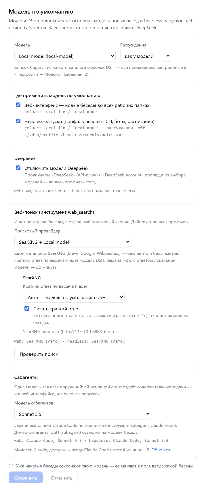

# dsh-model-settings

Два плагина для [DeepSeek Harness (DSH)](https://github.com/deepseek-ai/deepseek-harness),
которые собирают все настройки моделей DSH на одной странице: модель по умолчанию для
каждого профиля, полное отключение DeepSeek, провайдер веб-поиска и модель сабагентов.
Логика написана на Go; DSH загружает тонкие модули на JavaScript, которые запускают
Go-программу и связывают её с DSH.

[English version](README.md)

| Пакет | Что делает |
| --- | --- |
| [`dsh-model-defaults`](packages/dsh-model-defaults) | Раздел **«Модель по умолчанию»** в настройках DSH Web, маршруты хоста для него и защита сабагентов. |
| [`dsh-web-search-extra`](packages/dsh-web-search-extra) | Дополнительные провайдеры для инструмента `web_search`: **SearXNG** (с кратким ответом модели DSH, по желанию), **Claude** по подписке Claude Code и **«Авто»**. |

Страница работает и без плагина поиска — тогда дополнительные варианты поиска помечены как неустановленные.

## Зачем

В самом DSH нет единой настройки «модель по умолчанию»:

* модель, последней выбранная в поле ввода любой беседы, молча становится моделью по умолчанию — и только для профиля `web`;
* headless-запуски (`dsh --profile headless`: CLI-задачи, боты, расписания) живут со своей моделью по умолчанию, которую из интерфейса не поменять;
* DeepSeek встроен в базовый профиль: на странице «Модели» его провайдеры не удалить, а `web_search` ходит в API DeepSeek при любой модели.

## Страница настроек



Настройки → **«Модель по умолчанию»**:

* **Модель** и **уровень рассуждений** — из живого каталога моделей DSH, то есть всех провайдеров из «Настройки → Модели».
* **Где применить**: веб-интерфейс (новые беседы во всех рабочих папках) и профиль `headless`. Для каждого видно, какая модель стоит сейчас; отметки запоминаются.
* **Отключить модели DeepSeek** — во всех профилях сразу.
* **Веб-поиск**: DeepSeek (как в DSH из коробки), SearXNG, Claude или «Авто» (DeepSeek → SearXNG → Claude, берётся первый ответ). Кнопка **«Проверить поиск»** делает один настоящий запрос.
* **Сабагенты** — один выбор для всех поручений: «Авто» (модель беседы), модель Claude через Claude Code или любая модель каталога DSH. Выбор соблюдается: сабагент на другой модели не запустится (см. [защиту сабагентов](packages/dsh-model-defaults#subagent-guard)).
* Подсказки: начатые беседы сохраняют свою модель; кнопка **«Перезапустить DSH Web»** появляется, только когда живой список моделей разошёлся с файлом профиля.

### Модели подтягиваются сами

* **Модели DSH** берутся из того же каталога, что и в поле ввода беседы (`sessionController.modelCatalog()`): провайдер, добавленный в «Настройки → Модели», сразу появляется на странице.
* **Модели Claude** отдаёт сам Claude Code: программа запускает Claude Code этой машины (нативный бинарник Claude Agent SDK из профиля DSH или `claude` из `PATH`) и берёт список моделей из его ответа на `initialize` — того же вызова, что стоит за `supportedModels()` в SDK. Сообщение модели не отправляется, токены не тратятся; список кэшируется на час, ссылка **«Обновить»** запрашивает его заново. Без Claude Code или без входа страница показывает псевдонимы `opus`, `sonnet`, `haiku` и пишет об этом.

### Языки

Английский, китайский и русский. Страница следует языку DSH («Настройки → Общие → Язык»), по умолчанию — английский. В версиях DSH без русского языка интерфейса плагин добавляет его; непереведённые тексты самого DSH тогда показываются по-английски.

## Как это устроено

DSH загружает плагины как модули Node.js, а страница настроек работает в браузере. Поэтому каждый
плагин — тонкий модуль, который запускает программу `dsh-model-settings` (`dsh-model-settings serve`)
и разговаривает с ней через stdin/stdout: одно JSON-сообщение на строку, запросы в обе стороны.

* **Модуль** (JavaScript, внутри DSH) регистрирует маршруты, хук `tools/execute` и провайдеры
  `web_search` и даёт программе то, что есть только у DSH: каталог моделей, модель по умолчанию,
  `ctx.llm` и `ctx.web`.
* **Программа** (Go) делает всё остальное: состояние и сохранение страницы, чтение и правку файлов
  профилей под блокировкой DSH, проверку `dsh --dump-config` и откат, запуски Claude Code (список
  моделей и поиск), поиск через SearXNG и краткий ответ модели, решения защиты сабагентов.

На каждый экземпляр плагина работает один процесс программы; он завершается, когда DSH закрывает
связь, а если упадёт сам — следующий вызов запустит его снова. Страница в браузере
(`packages/dsh-model-defaults/lib/client.js`) остаётся на JavaScript.

| Путь | Что там |
| --- | --- |
| `cmd/dsh-model-settings` | программа: `serve` для DSH и несколько команд для ручной проверки |
| `internal/defaults` | страница настроек: состояние, сохранение, проверка поиска, перезапуск |
| `internal/profile` | что написано в профиле, какие изменения делает страница, правка/проверка/откат файла |
| `internal/yamledit` | правка YAML на месте: переписываются только строки изменённых ключей и записей |
| `internal/guard` | защита сабагентов (решения, переход на модель по умолчанию) |
| `internal/search` | провайдеры поиска SearXNG, Claude и «Авто» |
| `internal/claudecode` | Claude Code по его протоколу stream-json, список моделей Claude |
| `internal/fsutil` | блокировка профиля и атомарная запись, как в DSH |
| `internal/i18n` | сообщения сервера и комментарии в файлах (en, ru, zh) |
| `internal/rpc`, `internal/host` | связь со стороной DSH |
| `shim/sidecar.js` | сторона связи на JavaScript, общая для модулей плагинов |
| `packages/*` | пакеты DSH: манифесты, патчи бандлов, модули плагинов, страница в браузере |

## Требования

* DSH 0.2.1 или новее (проверено на 0.2.1-rc.5) и его Node.js (22+).
* Go 1.22+ для сборки программы — на машине с DSH или на любой другой (см. ниже).
* `pnpm` в `PATH` при `dsh plugin add` (команда передаёт работу pnpm).
* Для поиска через SearXNG — свой SearXNG с включённым форматом JSON (см. [SearXNG](#searxng)).
* Для поиска и сабагентов Claude — плагин `@deepseek-ai/dsh-subagent-claude-code` и вход в Claude Code на этой машине.
  На машине без браузера лучше годовой токен `claude setup-token` (вход `claude /login` истекает через несколько
  недель): `CLAUDE_CODE_OAUTH_TOKEN=…` в `~/.dsh/.env` для этих плагинов и в `env` файла `~/.claude/settings.json`
  для сабагентов Claude (DSH убирает переменные с именами вида `*TOKEN*` из окружения запускаемых процессов).

## Установка

```bash
git clone https://github.com/usamoilov/dsh-model-settings ~/src/dsh-model-settings
cd ~/src/dsh-model-settings
go build -o bin/ ./cmd/dsh-model-settings      # или: make build

# страница и защита сабагентов — в профиль, на котором работает DSH Web
dsh plugin --profile web add link:$HOME/src/dsh-model-settings/packages/dsh-model-defaults

# провайдеры поиска — во все профили, агенты которых должны ими пользоваться
dsh plugin --profile web add link:$HOME/src/dsh-model-settings/packages/dsh-web-search-extra
dsh plugin --profile headless add link:$HOME/src/dsh-model-settings/packages/dsh-web-search-extra

# затем перезапустите DSH Web тем способом, каким он у вас запущен (выполняющиеся беседы прервутся),
# например, для пользовательской службы systemd: systemctl --user restart <ваш-unit>.service
```

На машине с DSH нет Go? Соберите на другой и положите файл в `bin/` клона:

```bash
GOOS=linux GOARCH=amd64 CGO_ENABLED=0 go build -trimpath -o dsh-model-settings ./cmd/dsh-model-settings
scp dsh-model-settings dsh-host:src/dsh-model-settings/bin/
```

Модули ищут программу так: параметр плагина `binary`, `$DSH_MODEL_SETTINGS_BIN`,
`<клон>/bin/dsh-model-settings`, `dsh-model-settings` в `PATH`.

Обновление: `git pull` в клоне, заново собрать программу, перезапустить DSH Web. Установка `link:`
читает модули прямо из клона; если программа и модули разных версий, это видно в журнале DSH.

## Настройка

Оба плагина работают без настройки. Необязательные параметры — в строке плагина в
`~/.dsh/profiles/web/cordis.patch.yml`:

```yaml
- id: model-defaults
  config:
    # профили, которыми управляет страница (по умолчанию — текущий и headless, если есть)
    profiles: [web, headless]
    # ваш unit systemd --user для DSH Web, если он так запущен; включает кнопку перезапуска (по умолчанию выключена)
    webUnit: dsh-web.service
    # дополнительные --patch-файлы, которые повторяют модель Claude-сабагента (для службы,
    # запускаемой как `dsh --profile headless --patch base.patch.yml --patch extra.patch.yml`)
    overlays:
      - path: ~/svc/extra.patch.yml
        label: Моя служба
        profile: headless
        patches: [~/svc/base.patch.yml]   # патчи перед ним — для проверки сборки
    # адрес SearXNG для строки состояния на странице
    searxngURL: http://127.0.0.1:8888
```

Настройки провайдеров поиска описаны в [`dsh-web-search-extra`](packages/dsh-web-search-extra#configuration),
защиты сабагентов — в [`dsh-model-defaults`](packages/dsh-model-defaults#subagent-guard).

## SearXNG

Подойдёт любой SearXNG с форматом вывода JSON. Свой, в Docker, только на localhost:

```bash
mkdir -p ~/searxng/config
docker run -d --name searxng --restart unless-stopped \
  -p 127.0.0.1:8888:8080 -v ~/searxng/config:/etc/searxng \
  --memory 400m --cpus 1 searxng/searxng:latest
```

При первом запуске появится `~/searxng/config/settings.yml`. В нём задайте `search.formats:
[html, json]`, `server.limiter: false` (инстанс не публичный) и случайный `server.secret_key`,
затем `docker restart searxng`. Не кладите `settings.yml` в git — в нём секретный ключ.

## Безопасность

* Все маршруты — маршруты DSH и требуют cookie входа в DSH. `POST`-маршруты дополнительно требуют
  заголовок `x-dsh-model-defaults: 1` и JSON, поэтому сторонний сайт не отправит их формой.
  Cookie сессии в программу не передаётся.
* Файлы профилей правятся на месте: переписываются только строки тех ключей и записей, которые
  меняются, — комментарии, пустые строки, кавычки, свёрнутые строки, списки в квадратных скобках и
  `!!js`-выражения в остальных местах остаются байт в байт, а изменение без смысла файл не трогает.
  Запись идёт под блокировкой профиля DSH (той же, что берут его редактор настроек и `dsh plugin`),
  атомарно и с копией (`cordis.patch.yml.bak-model-defaults-*`, хранятся последние 5). После каждой
  записи `dsh --profile <имя> --dump-config` должен пройти и содержать выбранного провайдера — иначе
  файл возвращается к прежнему виду.
* Перезапуск (`systemctl --user --no-block restart <webUnit>`) доступен, только если задан `webUnit`
  (имя unit проверяется и никогда не становится строкой оболочки).
* Claude Code запускается с минимальным окружением (плюс переменные входа Claude, например
  `CLAUDE_CODE_OAUTH_TOKEN`, если они есть у DSH), без настроек, хуков, CLAUDE.md и MCP-серверов и без
  сохранения сессии. Список моделей читается без единого промпта; поиск через Claude разрешает только
  инструмент WebSearch, в пустой временной папке.

## Командная строка

Программу можно запускать и вручную, для проверки:

```bash
bin/dsh-model-settings read-profile ~/.dsh/profiles/headless/cordis.patch.yml   # что видит страница (JSON)
bin/dsh-model-settings claude-models ~/.dsh/profiles/web                        # список моделей Claude Code
bin/dsh-model-settings search searxng последняя версия Node.js                  # выдача SearXNG
bin/dsh-model-settings search -claude-model haiku claude-code latest Node.js    # один поиск через Claude (тратит лимиты)
bin/dsh-model-settings version
```

## Тесты

```bash
go test ./...                                           # модульные тесты, только Go
go build -o bin/ ./cmd/dsh-model-settings
node shim/test/integration.test.mjs                     # три модуля плагинов с программой в поддельном DSH
node packages/dsh-model-defaults/test/client.test.mjs   # отрисовка страницы на всех языках (браузер не нужен)
go test -tags live -v ./internal/profile                # на машине с DSH: реальные профили только читаются
```

`make test` запускает первые четыре. Интеграционному тесту нужны только Node.js и собранная программа;
live-тест читает реальные профили, правит их в памяти и один раз запускает `dsh --dump-config`.

## Удаление

```bash
dsh plugin --profile web remove dsh-model-defaults dsh-web-search-extra
dsh plugin --profile headless remove dsh-web-search-extra
# и перезапустите DSH Web
```

Сделанные через страницу изменения остаются в профилях. Чтобы вернуть настройки DSH по умолчанию,
до удаления переключите веб-поиск обратно на DeepSeek и снимите «Отключить модели DeepSeek» — или
удалите из `cordis.patch.yml` строки с комментарием `# dsh-model-defaults: …`.

## Лицензия

[MIT](LICENSE)
