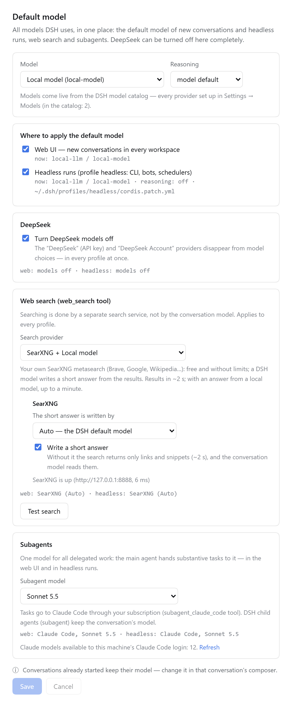

# dsh-model-defaults

The **Default model** section of DSH Web settings: one default model for every DSH
profile, a switch that turns DeepSeek off, the `web_search` provider and the subagent
model. The modules here connect DSH to the `dsh-model-settings` program, which does the work
(see [How it works](../../README.md#how-it-works)). Overview, install and configuration:
[repository README](../../README.md).



## What a save changes

Only the parts changed on the page are sent and written. Toggling DeepSeek alone does
not touch any profile's default model (so a `headless` profile keeps its own
`reasoningEffort: off`, for example) — except a profile whose default is a DeepSeek model:
it moves to the model shown on the page. Subagents running on DeepSeek likewise move to the
subagent choice shown on the page. The page says so before saving.

| Choice | Rows written in `cordis.patch.yml` |
| --- | --- |
| Default model | `agent-default-model` → `{ provider, model, reasoningEffort? }` |
| DeepSeek off | `disabled: true` on `llm-deepseek` (provider “DeepSeek”, API key) and `llm-deepseek-account` (“DeepSeek Account”) |
| Web search | `web` → `searchProvider` (restating `fetchProvider`: a profile row replaces the whole base config); `web-search-extra` → `claudeModel`, `summaryModel`, `summary`. DeepSeek's search rows `web-search-deepseek`, `web-deepseek-api` stay on only for DeepSeek search, and for Auto while DeepSeek models are on |
| Subagents: Claude | `tool-subagent-claude-code` on; `subagent-claude-code` → `model` (removed for Auto) in every profile and configured overlay; DSH child agents follow the conversation |
| Subagents: DSH model or Auto | `tool-subagent-claude-code` → `disabled: true`; the spawn `tool-subagent` row → `agentOptions: { provider, model }` (removed for Auto). In a profile that defines the agent preset this is the preset's copy, otherwise a top-level row with the base `provider: spawn`, `toolName: subagent` |

Agents can tell the route from their tools: with `subagent_claude_code` present, work goes
to Claude Code; without it, to `subagent`. Rules that say so need no change when the choice changes.

Safety rules: a DeepSeek model cannot be the default while DeepSeek is being turned off, and
DeepSeek cannot be turned off while a profile defaults to it, writes the search answer with it, or
runs subagents on it. The page moves such profiles along (see above), ticked or not; the host
refuses a save that would leave one behind.

## Where the default model applies

The ticks under “Where to apply the default model” are remembered (in `.model-defaults.json` next
to the running profile's `cordis.patch.yml`; every profile is ticked until saved otherwise):

* a new model goes to every ticked profile;
* an unticked profile keeps its own default model, and later model changes on the page leave it alone;
* ticking a profile again copies the model shown on the page into it on save;
* with the running profile unticked, the model select shows the default of the first ticked profile.

## Subagent guard

The subagent choice is enforced, not only suggested. The guard (`dsh-model-defaults/guard`,
row `model-defaults-guard`) wraps `tools/execute` and checks every call of a DSH delegation tool —
`subagent`, `subagent_fork`, `workflow` — before a child starts (the decision is made by the program,
[`internal/guard`](../../internal/guard)):

| Subagents | Refused |
| --- | --- |
| Claude Code (`subagent_claude_code` present) | every DSH child |
| a DSH model | a child on any other model (`subagent` carries the chosen model; `subagent_fork` and `workflow` children inherit the conversation's model) |
| Auto | a call that asks for a model other than the conversation's |

A workflow script that sets `provider`/`model` for its agents cannot be checked and is refused.
The model gets a tool error that names the allowed route.

**When the chosen model fails.** A run on the chosen model that ends with `stopReason: 'error'`
(`subagent/end`) or a delegation call that fails at once opens a fallback: children on the
**default model** are allowed until a run on the chosen model completes again, for at most
`fallbackMinutes` (default 60; `0` = never). The guard knows nothing about limits or prices, so
the reason does not matter: a used-up subscription, an unreachable local server, an API without
credit. The state lives in the guard's program process (one per DSH process): the web UI shares it
across conversations, a headless run starts closed. If the program cannot be reached, delegation is
refused with an error that says so, rather than let through unchecked.

The bundle mounts the guard in the profile that has this package (`web`). Other profiles need its
row — by package name when the package is linked there, or by file path:

```yaml
- insert:
    - id: model-defaults-guard
      name: '/path/to/dsh-model-settings/packages/dsh-model-defaults/lib/guard.js'
```

The page shows where the guard is missing.

## How changes apply

* **The running profile** (`web`): the default model is saved through DSH's own
  `agentDefaultModel` service — the same path as a pick in the composer. It re-reads the profile
  file and re-applies it live, so turning DeepSeek off usually needs no restart; when the live
  model list still differs from the file, the page offers a restart.
* **Other profiles** (`headless`): `~/.dsh/profiles/<name>/cordis.patch.yml` is edited on disk and
  applies from the next `dsh --profile <name>` run.

Each edit:

* rewrites only the lines of the keys and rows that change ([`internal/yamledit`](../../internal/yamledit)):
  comments, blank lines, quoting, folded strings, flow lists (`[serve]` or `[ serve ]`), `!!js`
  expressions and unrelated rows stay byte for byte, and a no-op leaves the whole file untouched;
* runs under DSH's profile lock (the `<file>.lock` protocol of `@deepseek-ai/dsh-atomic-write`, also
  taken by the config editor and `dsh plugin`) with an atomic write;
* keeps a copy `cordis.patch.yml.bak-model-defaults-<time>` (last 5);
* then checks `dsh --profile <name> [--patch …] --dump-config`: the profile must compose and contain the
  chosen provider, otherwise the file is restored and the page shows the error.

New rows carry a comment `# dsh-model-defaults: … (<time>)` in the page's language. Turning DeepSeek back
on removes only `disabled: true` and drops rows left with nothing else (with their `# dsh-model-defaults:`
comment). A `disabled` flag written as a `!!js` expression is never removed; turning DeepSeek off sets it to `true`.

## Config

Row `model-defaults` in the web profile, all optional:

| Key | Default | Meaning |
| --- | --- | --- |
| `profiles` | running profile + `headless` (those that exist) | profiles the page manages |
| `webUnit` | — | `systemd --user` unit of DSH Web; enables the restart button |
| `overlays` | `[]` | `[{ path, label, profile, patches }]` extra `--patch` files that restate `subagent-claude-code`; kept in sync with the Claude subagent model and checked with `dsh --profile <profile> --patch <patches…> --patch <path> --dump-config` |
| `searxngURL` | `http://127.0.0.1:8888` | SearXNG address for the health line |
| `binary` | `<clone>/bin/dsh-model-settings` | where the program is (also `$DSH_MODEL_SETTINGS_BIN`, then `PATH`) |

`~` at the start of a path is the home folder. The guard row (`model-defaults-guard`) takes
`fallbackMinutes` (default 60, `0` = never) and `binary`.

## Languages

Client texts live in [`lib/client.js`](lib/client.js) (namespace `modelDefaults`, registered with
`ctx.locale.register`); server messages and profile comments in
[`internal/i18n/i18n.go`](../../internal/i18n/i18n.go). The browser sends its active DSH locale in
`x-dsh-locale`; unknown locales get English. To add a language, add a dictionary with the same keys to
both files (the tests check that every language has every key and the same `{placeholders}`).

## API

Authenticated DSH routes (the web UI's cookie). `POST` requires `x-dsh-model-defaults: 1` and JSON.

* `GET /api/model-defaults.state[?refreshClaude=1]` — catalog, per-profile state, overlays,
  SearXNG health, `restartNeeded`, `canRestart`, the remembered ticks `apply: { web: true, headless: false }`,
  and `claude: { source: 'claude-code' | 'fallback', reason?, models, recommended }`.
* `POST /api/model-defaults.save` — `apply` lists the profiles that get `selection` in this save;
  `remember` (optional) stores the ticks:
  ```
  { selection: { provider, model, reasoningEffort } | null,
    apply: { web: true, headless: true },
    remember: { web: true, headless: false } | null,
    deepseek: { models: true },
    search: { provider: 'deepseek-official' | 'searxng' | 'claude-code' | 'auto',
              claudeModel: 'auto' | '<alias or id>', summaryModel: 'auto' | { provider, model }, summary } | null,
    subagents: { kind: 'claude', model: 'auto' | '<alias or id>' } | { kind: 'dsh', ref: 'auto' | { provider, model } } | null }
  ```
  → `{ state, notes }`.
* `POST /api/model-defaults.test-search` — `{ query }` → one search through the live `web` service.
* `POST /api/model-defaults.restart` — `systemctl --user --no-block restart <webUnit>`; only with `webUnit` set.

## Files

| File | Role |
| --- | --- |
| `lib/index.js` | host module: starts the program, registers its routes, lends it the catalog, the default model and `web` |
| `lib/guard.js` | guard module: the `tools/execute` and `subagent/end` hooks, decisions by the program |
| `lib/client.js` | the settings page (React through DSH's module loader) |
| `test/client.test.mjs` | renders the page in every language and checks what a save sends |
| [`internal/defaults`](../../internal/defaults) | state, save, test search, restart |
| [`internal/profile`](../../internal/profile) | reading and editing profile patches; compose check and rollback |
| [`internal/claudecode`](../../internal/claudecode) | Claude Code's model list |
| [`internal/guard`](../../internal/guard) | the guard's decisions and fallback window |
